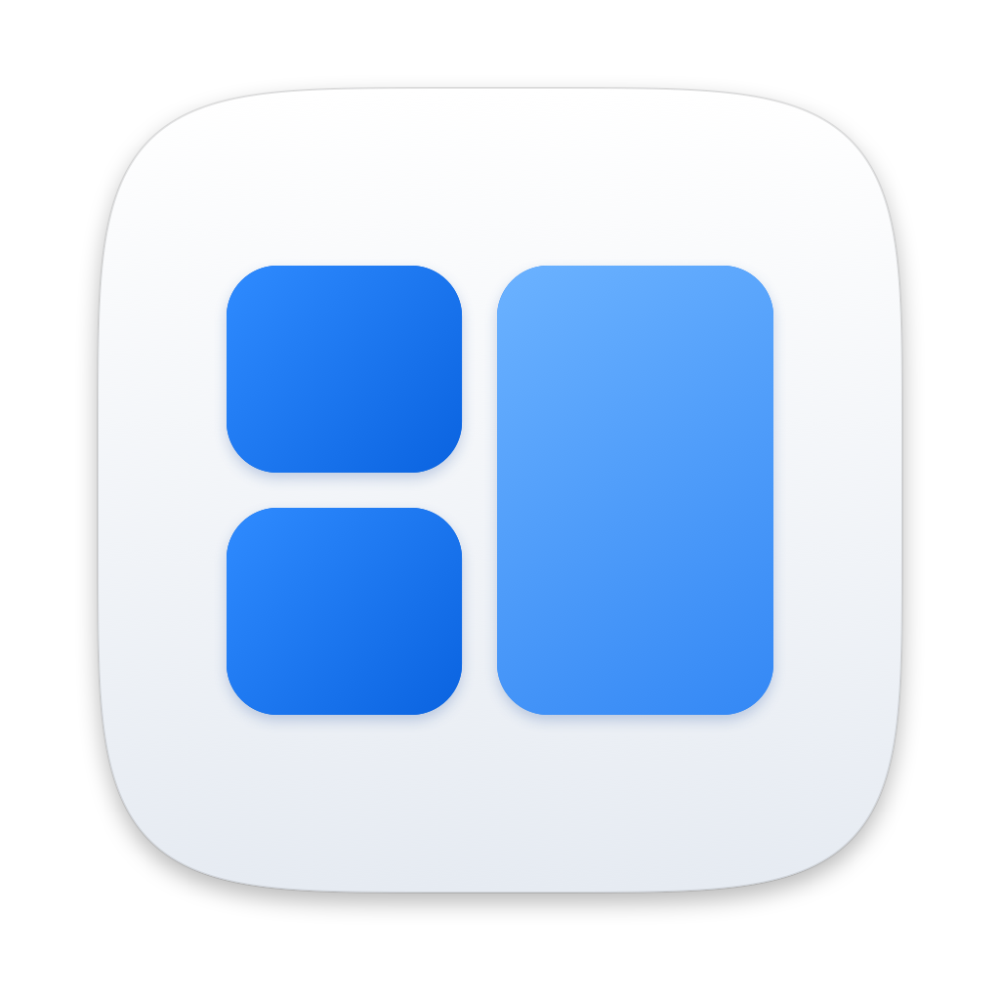
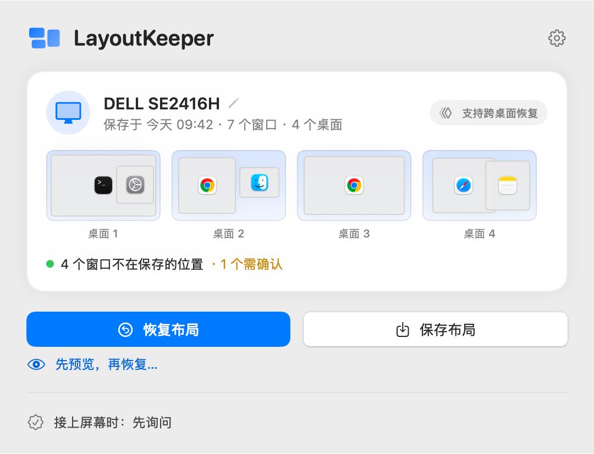
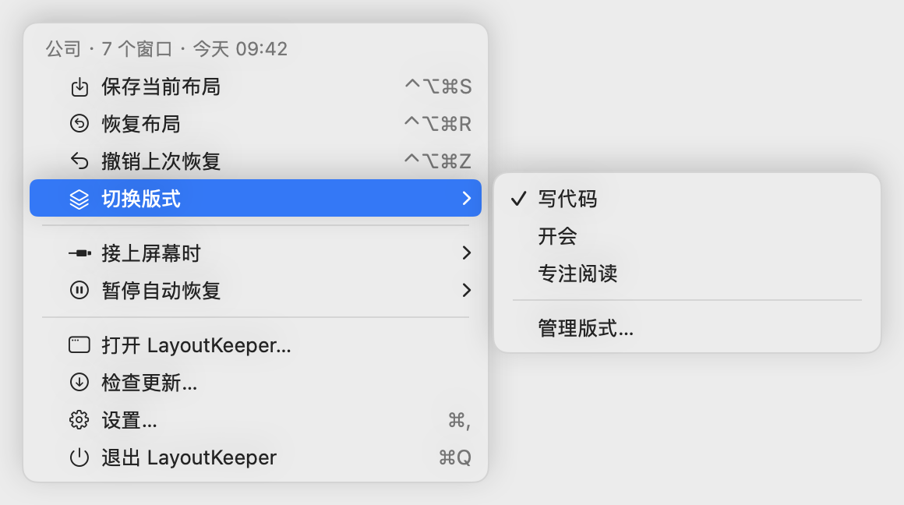
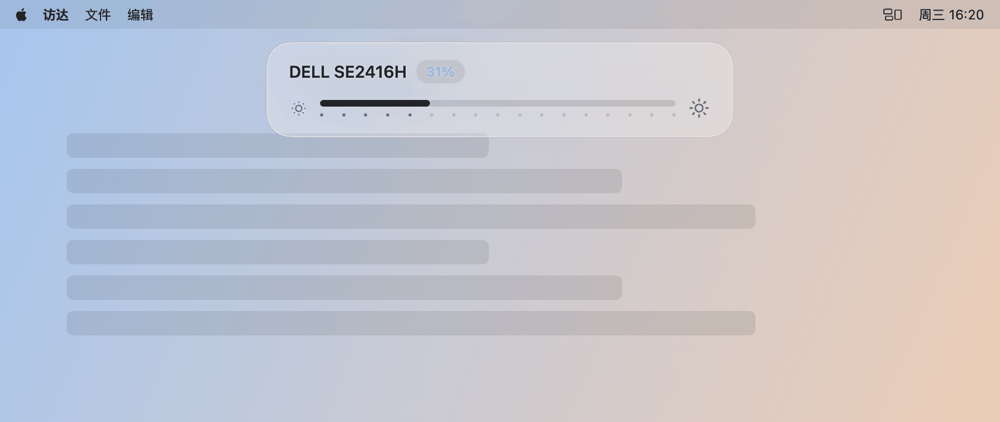
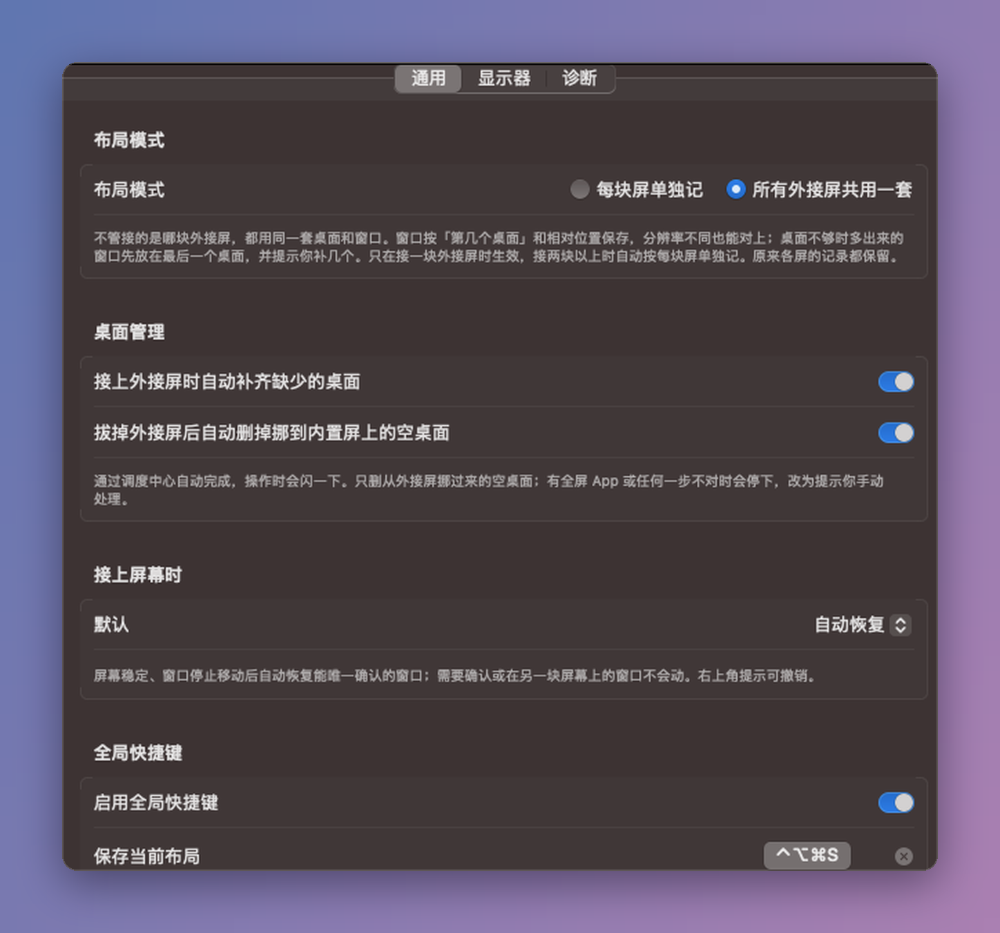
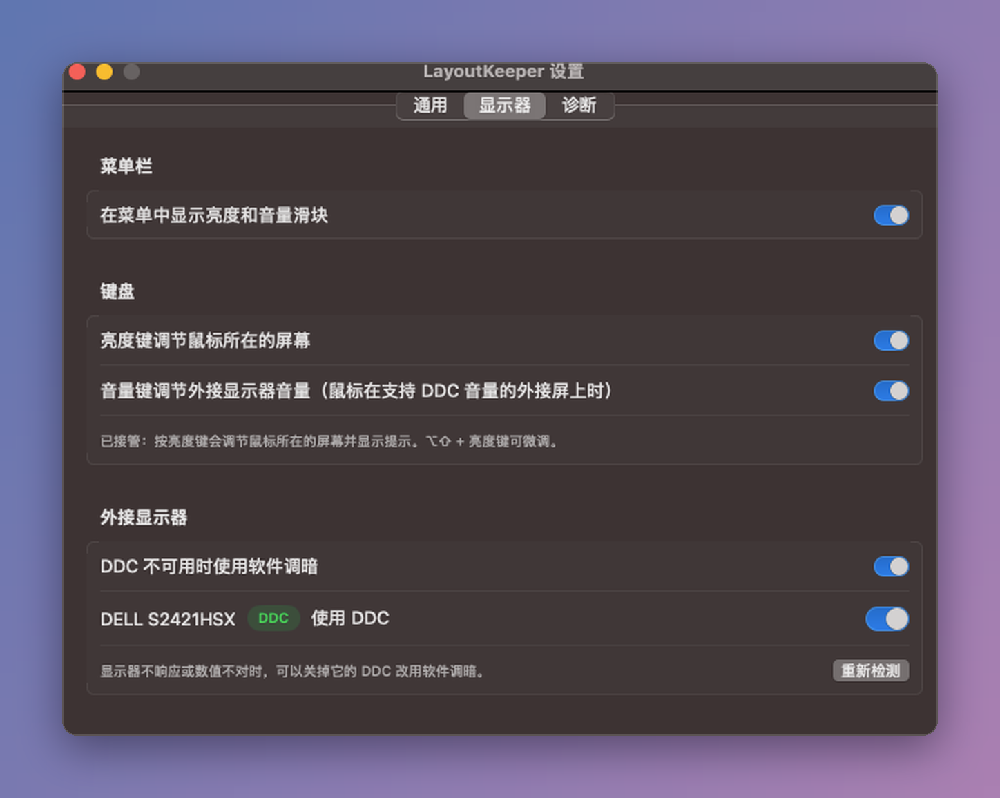
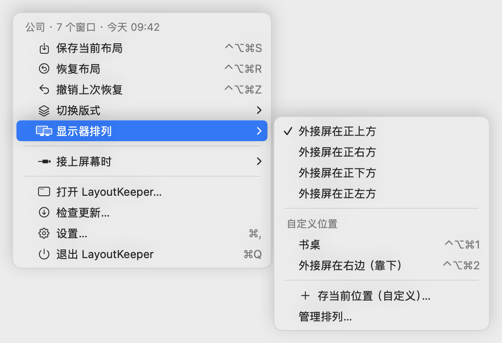
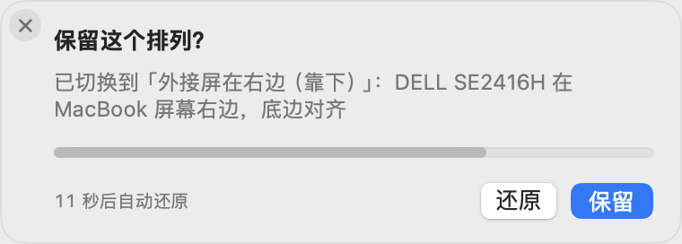

<p align="center"></p>

# LayoutKeeper

[English](README.md) · [简体中文](README.zh-CN.md) · **日本語** · [한국어](README.ko.md) · [Tiếng Việt](README.vi.md)

**外部モニターをつなぎ直すと、ウインドウが元の位置に戻ります。元のデスクトップ（操作スペース）にも戻ります。**

<p align="center"></p>

<p align="center">
  
  
</p>

## どんな問題を解決するか

会社と自宅でそれぞれ外部モニターを使っていると、外すたびに macOS がすべてのウインドウをノートの画面に寄せてしまいます。つなぎ直したら、デスクトップごとに手でウインドウを戻すしかありません。

LayoutKeeper はメニューバーに常駐し、外部モニター上の各ウインドウの位置を記憶します。**どのデスクトップ（Mission Control の操作スペース）にあったかも記憶します。** モニターをつなぐと、ワンクリックまたは自動で元に戻します。

> スクリーンショットはサンプルデータです。アプリは英語と簡体字中国語に対応し、システムの言語に合わせて切り替わります。

## 機能

- **モニターごとのレイアウト**：EDID（メーカー・型番・シリアル番号）でモニターを識別し、自宅用と会社用を別々に保存します。手で選ぶ必要はありません。
- **共通レイアウトも選べる**：外部モニターを一度に1台しか使わないなら「すべての外部モニターで共通」を選べます。会社でも自宅でも同じデスクトップとウインドウになります。位置は画面に対する比率で保存するので、解像度が違っても合います。
- **元のデスクトップに戻す**（macOS 26 以降）。同じデスクトップにあったウインドウは元の順番のまま同じデスクトップに戻し、2 つのグループを 1 つのデスクトップにまとめることはありません。それより古い macOS でも、現在のデスクトップ上の位置とサイズは復元できます。
- **デスクトップの自動追加**（共通モード、初期設定でオン）：つないだときは足りないデスクトップを Mission Control で追加します。デスクトップを削除することはありません。途中で何か合わなければ止まり、手動での対応を案内します。SIP を無効にする必要はありません。
- **輝度・音量キー**：輝度キーでマウスがある画面（内蔵・外部）の明るさを調整し、画面上部に半透明の表示を出します。音量キーは、マウスがどの画面にあっても Mac のシステム音量（現在のサウンド出力）を 3% 刻みで変えます。輝度のハードウェア制御（DDC）は **Apple シリコン搭載 Mac のみ**対応です。モニターが応答しない場合はソフトウェアで暗くします。BetterDisplay、MonitorControl、Lunar が起動中のときはキーを譲ります。
- **名前付きレイアウト**：1台のモニターに「コーディング」「会議」など複数のレイアウトを保存し、メニューバーから切り替えられます。
- **履歴**：モニターごとに直近 5 版を残すので、いつでも戻せます。
- **プレビューと取り消し**：復元前に各ウインドウの動きを確認でき、どの復元もワンクリックで取り消せます。
- **推測しない**：各ウインドウを動かすたびに実際の位置を確認し、失敗すれば元に戻します。同じ名前のウインドウを区別できないときはユーザーに確認します。
- **ディスプレイ配置**：同じ外部ディスプレイを MacBook の上に置いたり横に置いたりする場合、システム設定でドラッグしなくても、メニューバーから位置（真上・右・下・左）を選ぶだけで切り替えられます。それ以外の位置（左揃え、ずらし…）はカスタム位置として保存できます。切り替えてから 15 秒以内に **Keep** を押さないと元に戻ります。メインディスプレイと解像度は変わらず、ウインドウの復元も起きません。
- **グローバルショートカット**：⌃⌥⌘S 保存、⌃⌥⌘R 復元、⌃⌥⌘Z 取り消し。変更やオフもできます。
- **自動アップデート**（Sparkle）：アップデートは署名で検証され、アクセシビリティの許可もそのまま残ります。

<p align="center">
  
  
</p>

<p align="center">
  
  
</p>

## インストール

1. [Releases](https://github.com/tumingke0/LayoutKeeper/releases/latest) から `.dmg` をダウンロードします。M シリーズなら **AppleSilicon**、Intel Mac なら **Intel** を選びます。
2. LayoutKeeper を「アプリケーション」にドラッグします。
3. **初めて開くとき**は、アプリを右クリックして「開く」を選びます。「システム設定 → プライバシーとセキュリティ」の「このまま開く」でもかまいません。アプリは自己署名で Apple の公証を受けていないため、この手順が必要です。
4. 3ステップのガイドに従います。「アクセシビリティ」を許可し、ログイン時に起動するか選び、最初のレイアウトを保存します。

**アップデート**：メニューバー →「检查更新…」（アップデートを確認）を使います。初期設定では1日1回自動で確認します。どの版も同じ証明書で署名しているので、更新後に許可し直す必要はありません。
0.6.0 以前を使っている場合は、最後に一度だけ手動で新しい版をインストールし、アクセシビリティを許可し直してください。スイッチがオンなのに動かない場合は、「−」で LayoutKeeper を削除してから追加し直してください。

## 使い方

1. 外部モニターの各デスクトップでウインドウを並べます。
2. メニューバーのアイコン →「保存当前布局」（現在のレイアウトを保存）を選ぶか、⌃⌥⌘S を押します。
3. 次にそのモニターをつなぐと右上に通知が出ます。「恢复布局」（レイアウトを復元）をクリックするか、⌃⌥⌘R を押します。
4. 気に入らなければ ⌃⌥⌘Z で取り消します。

モニターをつないだときの動作（設定 → 一般）：
- **先に確認**（初期設定）：右上に閉じられる通知が出て、クリックするまで何も動きません。
- **自動で復元**：画面とウインドウが落ち着いてから復元します。
- **オフ**：手動でのみ復元します。

詳しくは [docs/USABILITY.md](docs/USABILITY.md)（中国語）をご覧ください。

## 動作環境

- macOS 14 以降。元のデスクトップに戻すには **macOS 26 以降**が必要です（macOS 27.0 で確認済み）。
- アクセシビリティの許可が必要です。画面収録や入力監視は不要です。
- 外部モニターは同時に **1台**まで。
- 「システム設定 → デスクトップと Dock →ディスプレイごとに個別の操作スペース」がオンであること（初期設定でオン）。

## 制限事項

- デスクトップ間の移動には macOS の非公開 API を使っているため、OS のアップデートで動かなくなることがあります。起動時に自動で確認し、必要ならこの機能をオフにします。同じデスクトップ内での復元には影響しません。
- Finder のウインドウは別のデスクトップに移せません。位置とサイズは復元されます。
- アプリの起動・終了、タブや重なり順の復元はしません。フルスクリーン、Split View、最小化されたウインドウはスキップします。
- ハードウェアでの輝度調整は Apple シリコンのみです。DDC に対応していないモニター、変換アダプタ、ドック、HDMI ポートもあります。

## よくある質問

**データを収集しますか？** しません。ネットワークを使うのはアップデートの確認だけで、接続先は GitHub のみです。設定でオフにできます。レイアウトは Mac 上の `~/Library/Application Support/LayoutKeeper/` にだけ保存されます。

**「要確認」と表示されるウインドウがあるのはなぜ？** 同じアプリに同じタイトルのウインドウが複数あり、推測で動かさないためです。プレビューで選んでください。

**macOS 14/15 でデスクトップ間の復元ができないのはなぜ？** 古いシステムのインターフェイスは macOS 14.5 からブロックされ、新しいものは macOS 26 からしかないためです。

**アンインストール方法は？** アプリを終了し、`LayoutKeeper.app` と `~/Library/Application Support/LayoutKeeper/` を削除して `defaults delete local.layoutkeeper.app` を実行します。最後にシステム設定の「ログイン項目」と「アクセシビリティ」から外してください。

**以前の名前は SpacePort？** はい。0.4.0 で改名しました。初回起動時に古いデータをコピーします。

## ソースからビルド

Xcode 16 以降（Swift 6）が必要です。

```sh
git clone https://github.com/tumingke0/LayoutKeeper.git
cd LayoutKeeper
./scripts/test.sh     # 任意：テストを実行
./scripts/build.sh    # build-products/LayoutKeeper.app を作成
open build-products/LayoutKeeper.app
```

キーチェーンに「LayoutKeeper Self-Signed」証明書があればそれで署名します。なければ ad-hoc 署名になり、ビルドし直すたびにアクセシビリティから削除して追加し直す必要があります。技術的な詳細は [docs/DEVELOPMENT.md](docs/DEVELOPMENT.md) をご覧ください。

## コントリビュート

Issue と Pull Request を歓迎します。[CONTRIBUTING.md](CONTRIBUTING.md) をご覧ください。不具合を報告するときは、macOS のバージョン（ビルド番号を含む）と「設定 → 诊断 → 一键自检」（セルフテスト）のレポートを添えてください。レポートにウインドウのタイトルは含まれません。

## 謝辞

- [AltTab](https://github.com/lwouis/alt-tab-macos)（GPL-3.0）：他のデスクトップのウインドウを見つける考え方。実装は独自です。
- [yabai](https://github.com/koekeishiya/yabai)（MIT）：WindowServer のウインドウフラグの意味。
- [MonitorControl](https://github.com/MonitorControl/MonitorControl)（MIT）：DDC 制御の参考。
- SnapBack：モニター接続時に復元する操作の考え方。

[THIRD_PARTY_NOTICES.md](THIRD_PARTY_NOTICES.md) もご覧ください。

## ライセンス

[GPL-3.0-only](LICENSE)。Copyright (C) 2026 LayoutKeeper contributors.
