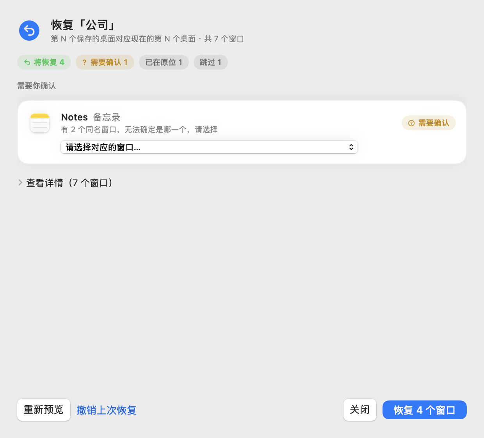
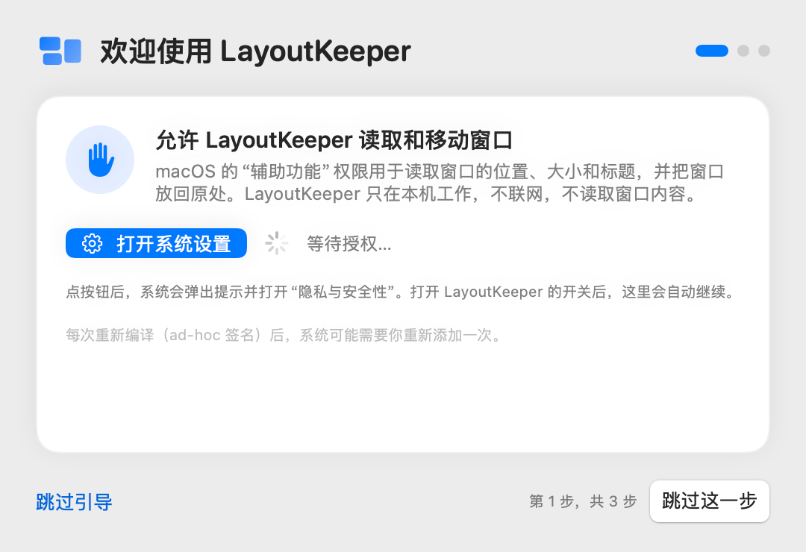
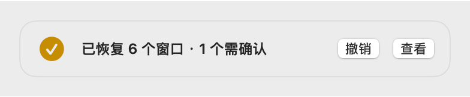

<p align="center"></p>

# LayoutKeeper

**记住并恢复外接屏窗口布局，支持跨 Mission Control 桌面。**
*Remember and restore your external-monitor window layout — across Mission Control Spaces.*

<p align="center">
  
  
</p>

在家和公司之间来回插拔外接显示器，窗口总是挤回内建屏、乱成一团？LayoutKeeper 常驻菜单栏，按屏幕硬件记住每个桌面上的窗口在哪里，接上屏幕时一键（或自动）放回原处：**包括放回原来的第几个桌面**。

[English](#english) · [使用说明](docs/USABILITY.md) · [开发与技术说明](docs/DEVELOPMENT.md) · 许可证 GPL-3.0

> 截图均为示例数据。

## 功能

- **按屏幕记住布局**：用显示器的 EDID（厂商/型号/序列号）区分家里和公司的屏幕，各存一份，不用选“场景”。
- **跨桌面恢复**：保存时记录窗口在外接屏的第几个普通桌面，恢复时把窗口移回对应桌面，再调整位置和大小（macOS 26+）。
- **先预览、可撤销**：可以先看每个窗口会怎么动；每次恢复都能一键撤销，回到恢复前的桌面、位置和大小。
- **逐个回读确认**：每个窗口移动后都重新读取，确认真的到了目标桌面和位置；失败的会回滚，不会“假装成功”。
- **不猜**：同名窗口分不清时标为“需要确认”，由你选，不会移错窗口。
- **菜单栏 + 全局快捷键**：⌃⌥⌘S 保存、⌃⌥⌘R 恢复、⌃⌥⌘Z 撤销，可自定义或关闭。
- **接上屏幕时**：每块屏幕第一次接上时问一次“以后自动恢复？”；自动恢复会等窗口稳定后再动，右上角轻提示可撤销。
- **首次使用引导**：授权、开机自启、保存第一份布局，三步完成。

<p align="center">
  
  
</p>

## 和其他窗口工具有什么不同

| | LayoutKeeper | 常见的窗口布局工具 |
| --- | --- | --- |
| 把窗口放回**原来的桌面（Space）** | ✅ macOS 26+ | 多数只恢复位置和大小 |
| 按显示器硬件自动区分布局 | ✅ | 常需手动选择 |
| 恢复前逐窗口预览 | ✅ | 少见 |
| 一键撤销 | ✅ | 少见 |
| 每个窗口回读确认、失败回滚 | ✅ | 少见 |
| 需要关闭 SIP / 注入 Dock | ❌ 不需要 | 部分工具需要 |

## 系统要求

- macOS 14 或更新（同一桌面内的位置/大小恢复）。
- **跨桌面恢复**：macOS 26 及以上，且系统中存在所需的私有接口（启动时自动检测，缺失时自动关闭此功能）。已在 **macOS 27.0 (26A428)** 上通过一键自检和真实窗口测试；其他 26+ 版本会提示“尚未自检”。
- 需要“辅助功能”权限。
- 目前只支持**一块**外接屏。

## 安装（从源码构建）

需要 Xcode 16 或更新（Swift 6 工具链）。本项目在 Swift 6.4 / macOS 27 SDK 上开发。

```sh
git clone https://github.com/tumingke0/LayoutKeeper.git
cd LayoutKeeper
./scripts/test.sh                 # 可选：运行单元测试
./scripts/build.sh                # 生成 build-products/LayoutKeeper.app
open build-products/LayoutKeeper.app
```

- 构建使用 **ad-hoc 签名**（不需要开发者账号）。**每次重新构建后，macOS 会把它当成新应用**：如果功能失效，到“系统设置 → 隐私与安全性 → 辅助功能”删除旧的 LayoutKeeper 再重新添加（点 +，⌘⇧G 输入 `build-products/LayoutKeeper.app` 的路径）。
- 可以把 `LayoutKeeper.app` 拖到“应用程序”文件夹再使用。
- 从网上下载的预编译版本没有经过 Apple 公证：第一次请在 Finder 里**右键 → 打开**，或在“系统设置 → 隐私与安全性”里点“仍要打开”。

## 使用

1. 第一次打开会出现三步引导：授权辅助功能 → 开机自启 → 保存第一份布局。
2. 把外接屏各个桌面上的窗口摆好，菜单栏图标 → **保存当前布局**（⌃⌥⌘S）。
3. 下次接上这块屏幕：菜单栏 → **恢复布局**（⌃⌥⌘R），或让它自动恢复。按住 Option 是“预览后恢复…”。
4. 不满意？**撤销上次恢复**（⌃⌥⌘Z），或点提示里的“撤销”。

**接上屏幕时**（菜单栏或设置 → 通用）：

- **先询问**（默认）：每块屏幕第一次接上时问一次“以后自动恢复？”，记住你的选择。
- **自动**：屏幕稳定 3 秒、窗口停止移动后自动恢复能唯一确认的窗口；需要确认的、在另一块屏幕上的窗口不会动。
- **关闭**：只手动恢复。
- 可以暂停自动恢复 1 小时或到明天。

<p align="center"></p>

详细说明见 [docs/USABILITY.md](docs/USABILITY.md)。

## 工作原理（简述）

- **读取窗口**：辅助功能（AX）API 读取各应用的窗口；`kAXWindows` 只给出当前桌面的窗口，其他桌面的窗口用公开窗口列表算出候选，再通过远程元素令牌（`_AXUIElementCreateWithRemoteToken`）找回，并校验进程和窗口编号。
- **桌面信息**：通过 SkyLight（`SLSCopyManagedDisplaySpaces`、`SLSCopySpacesForWindows`）读取外接屏的桌面列表和窗口所在桌面。布局只保存“第几个桌面”这样的序号。
- **跨桌面移动**：macOS 26+ 的 `SLSBridgedMoveWindowsToManagedSpaceOperation`，移动后回读窗口所在桌面；确认到位后再用 AX 写位置和大小，再次回读。失败的项目回滚。
- **匹配**：应用 bundle ID 必须一致；有文档路径用路径，否则用标题（浏览器会去掉未读数和后缀）；重名时用桌面序号和位置挑唯一一个，仍不唯一就请你确认。

更多细节：[docs/DEVELOPMENT.md](docs/DEVELOPMENT.md)、[docs/COMPATIBILITY.md](docs/COMPATIBILITY.md)。

## 局限

- 跨桌面移动依赖**私有 API**，系统更新后可能失效（应用会自动检测并关闭该功能，同一桌面内的恢复不受影响）。
- **访达（Finder）**窗口无法跨桌面移动（拿不到进程启动时间，无法通过身份校验）；同一桌面内调整位置不受影响。
- 需要开启“系统设置 → 桌面与程序坞 → **显示器具有单独的空间**”（系统默认开启）；关闭时外接屏没有独立桌面，未测试。
- 不会新建、删除或重排桌面：桌面不够时会提示你先在调度中心新建。
- 不会启动或退出应用，不恢复标签页、Z 顺序；全屏 / Split View、最小化的窗口会跳过。
- 目前只支持一块外接屏。

## 隐私

- **只在本机运行，不联网**，没有统计或更新检查。
- 布局保存在 `~/Library/Application Support/LayoutKeeper/`，内容是应用 ID、窗口标题或文档路径、第几个桌面、归一化的位置和大小。**不保存窗口 ID、Space ID 或显示器运行时 UUID**。
- 窗口标题只保存在你自己的 Mac 上（布局文件和撤销日志里）；自检报告和诊断导出不含窗口标题（只有短哈希），可以放心附在 Issue 里。
- 只需要“辅助功能”权限；不需要屏幕录制、输入监控等权限。

## 常见问题

**重新构建后快捷键或恢复没反应？** ad-hoc 签名每次构建都会变，请在“辅助功能”里删除旧条目再添加新的 `LayoutKeeper.app`。

**为什么有的窗口显示“需要确认”？** 同一应用有多个同名窗口、又无法用桌面和位置唯一区分时，LayoutKeeper 不会猜，请在预览里选择。

**为什么不支持 macOS 14/15 的跨桌面恢复？** 旧的跨桌面接口从 macOS 14.5 起被系统拦截，新接口从 macOS 26 才有。

**会不会把窗口移乱？** 每个窗口移动后都会回读确认，失败的会回滚，每次恢复都能撤销。

**怎么卸载？** 退出应用，删除 `LayoutKeeper.app` 和 `~/Library/Application Support/LayoutKeeper/`，运行 `defaults delete local.layoutkeeper.app`，并在“系统设置 → 通用 → 登录项”和“辅助功能”里移除它。

**原来叫 SpacePort？** 是的，0.4.0 改名。首次启动会从旧文件夹复制数据（不移动、不删除）。

## 参与贡献

欢迎提 Issue 和 Pull Request，见 [CONTRIBUTING.md](CONTRIBUTING.md)。报告问题时请附上 macOS 版本（含 build 号）和“设置 → 诊断 → 一键自检”的报告。

## 致谢

- [AltTab](https://github.com/lwouis/alt-tab-macos)（GPL-3.0）：查找其他桌面窗口的技术思路（本项目独立实现，未复制代码）。
- [yabai](https://github.com/koekeishiya/yabai)（MIT）：WindowServer 窗口标记位的含义，见 [THIRD_PARTY_NOTICES.md](THIRD_PARTY_NOTICES.md)。
- SnapBack（Apache-2.0）：接上屏幕后恢复的交互思路（仅参考思路，无代码）。

## 许可证

[GNU General Public License v3.0 only](LICENSE)（`GPL-3.0-only`）。Copyright (C) 2026 LayoutKeeper contributors.

---

## English

**LayoutKeeper** is a macOS menu-bar app that remembers where your windows were on an external monitor — including **which Mission Control Space (desktop)** each window was on — and puts them back when you reconnect that monitor.

- **Per-monitor layouts**, identified by EDID (vendor/model/serial): home and office screens are stored separately.
- **Cross-Space restore** on macOS 26+ (when the required private SkyLight APIs are present; detected at launch). Tested on macOS 27.0 (26A428).
- **Preview, undo, read-back verification**: every moved window is read back and rolled back on failure; every restore can be undone.
- **No guessing**: ambiguous windows are marked "needs confirmation" instead of being moved.
- **Menu bar + global hotkeys**: ⌃⌥⌘S save, ⌃⌥⌘R restore, ⌃⌥⌘Z undo (configurable). Optional automatic restore on reconnect, asked once per monitor.
- **Local only**: no network access; layouts store app IDs, titles/document paths, desktop indices and normalized frames — never window IDs or Space IDs.

**Requirements**: macOS 14+ (same-Space restore); macOS 26+ for cross-Space restore; Accessibility permission; one external monitor.

**Build from source** (Xcode 16+ / Swift 6):

```sh
git clone https://github.com/tumingke0/LayoutKeeper.git && cd LayoutKeeper
./scripts/build.sh && open build-products/LayoutKeeper.app
```

Builds are ad-hoc signed; after each rebuild, remove and re-add LayoutKeeper under System Settings → Privacy & Security → Accessibility. Prebuilt downloads are not notarized: right-click → Open the first time.

**Limitations**: relies on private APIs that may break with OS updates; Finder windows can't be moved across Spaces; "Displays have separate Spaces" should be on; LayoutKeeper never creates or reorders Spaces; one external monitor only.

The UI is currently Chinese only. Contributions welcome — see [CONTRIBUTING.md](CONTRIBUTING.md). Licensed under [GPL-3.0-only](LICENSE).
